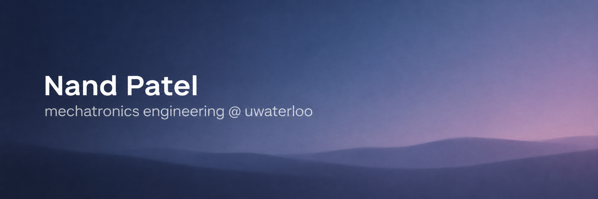

# hey, i’m nand 👋

i’m a first-year tron student @ uwaterloo. i like building robots, writing firmware, and automating things i’d rather do once.

right now, i work on drone autonomy with WARG and write firmware for Midnight Sun’s solar car. outside of those teams, i’m working on a six-wheel rover and learning more about motor control.

if you’re working on something cool or just want to chat, feel free to reach out!

 
